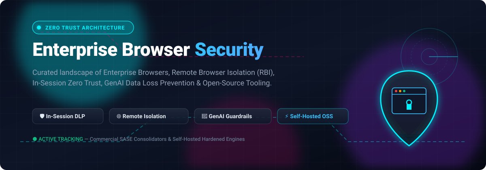

# Awesome Enterprise Browser Security 🛡️🌐

  

 

**A curated index of Enterprise Browser Security platforms, Remote Browser Isolation (RBI), In-Session Zero Trust, GenAI Data Loss Prevention (DLP), and self-hosted open-source browser sandboxing technologies.** 🚀

---

## 📌 Executive Summary & Introduction

Welcome to **Awesome Enterprise Browser Security**! 🌟 The web browser is the modern enterprise operating system and the primary workspace for SaaS apps, GenAI workflows, and corporate communications. Securing web interactions has moved beyond perimeter firewalls and legacy VPNs directly into the **in-session layer**.

This repository catalogs:
- 🏢 **Enterprise SaaS & SASE Platforms**: Native enterprise browsers, browser detection & response (BDR), and remote isolation platforms.
- 💻 **Open-Source GitHub Projects**: Community-driven isolation engines, hardened Chromium/Firefox builds, configuration templates, and penetration testing frameworks.
- 📊 **Sector Analytics & Market Intelligence**: M&A tracking, vendor market size, pricing tiers, and comparative architectures.

---

## 📑 Table of Contents

- [📈 Sector Overview & Market Dynamics](#-sector-overview--market-dynamics)
- [🏢 SaaS/Hosted Platforms](#-saashosted-platforms)
- [💻 Open-Source GitHub Projects](#-open-source-github-projects)
- [🤝 How to Contribute](#-how-to-contribute)
- [💖 Support & Sponsorship](#-support--sponsorship)
- [📈 Star History](#-star-history)
- [⚖️ Disclaimer](#️-disclaimer)

---

## 📈 Sector Overview & Market Dynamics

The global enterprise browser and browser security market is currently estimated between **$1.5B and $3.4B**, accelerating at a **~21% CAGR** toward an estimated **$8.5B–$10B+ by 2030**. 

The sector is **moderately to highly concentrated at the top**—with over 70% of market value commanded by leading cybersecurity giants and category pioneers (*Google, Palo Alto Networks, CrowdStrike, Zscaler, Island*). Aggressive consolidation through multi-hundred-million-dollar acquisitions (*Palo Alto acquiring Talon for >$600M, Akamai acquiring LayerX for ~$205M, CrowdStrike acquiring Seraphic, and Zscaler acquiring SquareX*) underscores a clear market trend: enterprise browser security is becoming a core pillar of modern Zero Trust and SASE architectures.

---

## 🏢 SaaS/Hosted Platforms

The following enterprise platforms offer managed browser governance, remote isolation, and in-session zero-trust data protection. Products are sorted in **descending order by vendor market size / valuation**.

| Platform | Parent Vendor | Company Size (Market Cap / Valuation / Revenue) 🏢 | Starting Pricing (Specific Tier) 💵 | Free Tier / Trial Limits ⏱️ | Key Architectural Focus & Delivery 🛡️ |
|:---|:---|:---|:---|:---|:---|
| **Google Chrome Enterprise Premium** | Alphabet Inc. (Google) | Market Cap: **~$3.98T** (FY25 Rev: ~$350B) | **$6.00 / user / month** ($72 / user / year) | **Free forever tier** (Chrome Enterprise Core) for up to 10 admin seats with unlimited fleet browsers; lacks paid DLP, real-time phishing, and context-aware Zero Trust policies | Native browser tier with integrated DLP, context-aware access, and deep malware protection without changing browsers. |
| **Broadcom Symantec Web Isolation** | Broadcom Inc. | Market Cap: **~$1.60T** (FY25 Rev: ~$51B) | **~$20.13 / user / year** (reseller list; cloud suites from $75 / user / year) | **90-day trial** via Broadcom Support portal (eval licenses typically feature a 30-day initial grace period before activation) | Cloud remote browser isolation (RBI) executing untrusted web code in isolated containers away from corporate endpoints. |
| **Palo Alto Prisma Access Browser (Talon)** | Palo Alto Networks | Market Cap: **~$135B** (FY25 Rev: $9.2B) | **~$35.00 / user / year** (baseline enterprise SASE browser add-on benchmark; enterprise-bundled) | **30-day free trial** available via AWS Marketplace / Sales PoC (enterprise evaluation licenses) | Dedicated Chromium enterprise browser integrated into Prisma SASE; deep BYOD/contractor data security and DLP. |
| **CrowdStrike Falcon Secure Access (Seraphic)** | CrowdStrike Holdings | Market Cap: **~$105B** (FY25 Rev: $3.95B) | **$59.99 / device / year** ($4.99/mo, baseline Falcon Go platform entry; browser module requires Falcon ecosystem) | **15-day free trial** of Falcon platform (no credit card required; access to console and endpoint policy testing) | Engine-level browser runtime security across any standard browser; JavaScript randomization and in-session zero trust. |
| **Zscaler Zero Trust Browser (SquareX)** | Zscaler, Inc. | Market Cap: **~$41.8B** (FY25 Rev: $2.17B) | **$50.00 / user / year** (~$4.17/mo, baseline browser isolation add-on; advanced SKUs up to $120–$180/yr) | **30-day trial** for advanced security modules (formal PoC evaluations configurable up to 60–90 days) | Browser Detection & Response (BDR), extension monitoring, and client-side zero-trust DLP bundled into Zero Trust Exchange. |
| **Akamai Workforce Protector (LayerX)** | Akamai Technologies | Market Cap: **~$13.5B** (FY25 Rev: $3.9B) | **~$395.00 / year** (entry organizational package list benchmark; enterprise seat-based per user) | **No free tier**; 14-to-30 day structured Proof of Concept (PoC) evaluation available upon sales qualification | Lightweight browser extension for shadow AI governance, GenAI DLP, and browser extension risk management. |
| **Island Enterprise Browser** | Island Technology Inc. | Valuation: **$6.4B** (Series F; $100M+ ARR) | **$18.00 / user / month** (MSP seat baseline; direct enterprise contracts start at $25,000–$250,000/yr commitments) | **60-day evaluation trial** under standard Carahsoft / enterprise subscription evaluation terms | Custom Chromium enterprise browser acting as a local VDI replacement with full policy, clipboard, and file exfiltration governance. |
| **Menlo Security** | Menlo Security Inc. | Valuation: **$800M** (Series E; ARR: $100M+) | **$130.00 / user / year** ($10.83 / user / month on AWS Marketplace baseline 0–99 seat band) | **30-day evaluation trial** under standard Menlo EULA terms (provides temporary cloud sandbox/isolation access) | Secure digital twin cloud browser isolation delivering safe rendering to any browser without local agents. |
| **Authentic8 Silo** | Authentic8, Inc. | Revenue: **~$50M–$100M** (Series/Debt: $12M+) | **$1,450.00 / user / year** (~$120.83/mo, Silo Workspace Local Plan; Multi-Region $2,450/yr, Global $3,450/yr) | **30-day free trial** for individual evaluation (limited egress nodes and prompt allocations) | Cloud-native isolated container browser designed for investigations, OSINT, and managed attribution networking. |

### 🔍 SaaS Platform Profiles & Architectural Paradigms

- 🛡️ **CrowdStrike Falcon Secure Access (Seraphic)**: Engine-level runtime security that attaches dynamically to standard browsers (Chrome, Edge, Safari) without replacing them. Uses client-side JavaScript engine randomization to mitigate zero-day exploits and enforces telemetry-backed in-session zero trust.
- 🏝️ **Island Enterprise Browser**: Purpose-built Chromium enterprise workspace browser replacing high-overhead Virtual Desktop Infrastructure (VDI). Delivers complete clipboard control, watermark rendering, local download blocking, and central management.
- 🦅 **Palo Alto Prisma Access Browser (Talon)**: Enterprise browser tightly woven into Palo Alto Networks' Prisma SASE fabric. Secures unmanaged endpoints, contractor laptops, and BYOD sessions without installing full system agents.
- 🌐 **Google Chrome Enterprise Premium**: Cloud-native governance built natively into Google Chrome. Adds context-aware access control, DLP inspection for enterprise data paste/upload, and real-time URL classification.
- ☁️ **Menlo Security**: Remote browser isolation pioneer utilizing a cloud-based secure digital twin architecture to stream sanitised DOM/pixels, guaranteeing that exploit code never touches physical endpoints.
- 🔌 **Akamai Workforce Protector (LayerX)**: High-performance browser extension providing Shadow SaaS and Shadow AI discovery, dynamic GenAI prompt inspection, and extension permission sandboxing.
- ⚡ **Zscaler Zero Trust Browser (SquareX)**: Browser Detection and Response (BDR) suite embedded into Zscaler Zero Trust Exchange to intercept client-side browser attacks, Browser-in-the-Middle (BitM/BitB) phishing, and malicious extensions.
- 🕵️ **Authentic8 Silo**: Cloud-native disposable browser isolated from corporate networks, tailored specifically for investigative intelligence, fraud analysts, OSINT researchers, and law enforcement.
- 🏢 **Broadcom Symantec Web Isolation**: Enterprise remote browser isolation engine integrated with Symantec Secure Web Gateway (SWG) and Web Security Service (WSS) to air-gap web execution.

---

## 💻 Open-Source GitHub Projects

Open-source tooling provides transparent components for remote isolation, script blocking, system sandboxing, and browser attack surface auditing.

Projects below are sorted in **descending order by GitHub star count**. Beside each repository name is a live social badge linking directly to that project's stargazers page:

### 1. [uBlock Origin](https://github.com/gorhill/uBlock)  🛡️
- **Description**: Efficient, wide-spectrum content-blocking browser extension that strips malicious advertising networks, tracking scripts, coin miners, and known malware vectors at the network layer.
- **License**: GPL-3.0
- **Use Case**: Eliminating initial browser attack vectors and script execution overhead on standard desktop browsers.

### 2. [Ungoogled Chromium](https://github.com/eloston/ungoogled-chromium)  🌐
- **Description**: Lightweight drop-in replacement for Google Chromium with Google web service dependencies, background tracking telemetry, and proprietary binaries completely scrubbed.
- **License**: BSD-3-Clause
- **Use Case**: Privacy-hardened baseline browser deployments for organizations avoiding external cloud telemetry.

### 3. [Brave Browser](https://github.com/brave/brave-browser)  🦁
- **Description**: Open-source privacy browser based on Chromium featuring built-in Shields (ad/tracker blocking, fingerprint randomization, bounce tracking protection) and native Tor onion routing.
- **License**: MPL-2.0
- **Use Case**: Turnkey privacy and secure browsing across desktop and mobile workstations.

### 4. [Neko](https://github.com/m1k1o/neko)  🐱
- **Description**: Self-hosted browser running inside Docker that streams interactive web sessions over WebRTC directly to the client. Features multi-user collaboration and disposable container lifecycles.
- **License**: Apache-2.0
- **Use Case**: Self-hosted, real-time remote browser isolation and interactive shared browsing sessions.

### 5. [Arkenfox user.js](https://github.com/arkenfox/user.js)  🦊
- **Description**: The definitive Firefox configuration hardening template. Enforces strict anti-fingerprinting (RFP), disables telemetry, isolates first-party states, and restricts privileged web APIs.
- **License**: MIT
- **Use Case**: Automated enterprise-wide hardening and standardized security baselines for Firefox deployments.

### 6. [BeEF (The Browser Exploitation Framework)](https://github.com/beefproject/beef)  🥩
- **Description**: Penetration testing tool focused specifically on the web browser. Hooks client browsers to evaluate client-side security postures, session hygiene, and cross-site execution vulnerabilities.
- **License**: GPL-2.0
- **Use Case**: Red-teaming and validating organizational defense-in-depth against in-browser attacks.

### 7. [Firejail](https://github.com/netblue30/firejail)  🔥
- **Description**: Linux SUID sandbox program that restricts the running environment of untrusted applications (including Chromium, Firefox, and Tor) using Linux namespaces, seccomp-bpf filters, and cgroups.
- **License**: GPL-2.0
- **Use Case**: Local system isolation preventing compromised browser sessions from accessing host filesystems or internal network interfaces.

### 8. [KasmVNC](https://github.com/kasmtech/KasmVNC)  🖥️
- **Description**: Modern open-source VNC server and client engineered for web browsers. Supports WebSocket streaming, WebRTC, clipboard sharing controls, data loss prevention (DLP), and dynamic resolution resizing.
- **License**: GPL-2.0
- **Use Case**: Underlying streaming infrastructure for building self-hosted Remote Browser Isolation (RBI) platforms.

### 9. [BrowserBox](https://github.com/BrowserBox/BrowserBox) [?style=social&color=white)](https://github.com/BrowserBox/BrowserBox/stargazers) 📦
- **Description**: Open-source remote browser isolation (RBI) solution that streams sandboxed Chrome instances over WebRTC/WebSocket, providing a secure, embeddable sandbox for browsing untrusted sites.
- **License**: PolyForm Noncommercial / Dual
- **Use Case**: Disposable isolated browsing, sandboxed malware analysis, and zero-trust remote web access.

### 10. [Pyllyukko user.js](https://github.com/pyllyukko/user.js)  🔒
- **Description**: Comprehensive `user.js` configuration file designed to harden Firefox against web tracking, fingerprinting, and unwanted browser-based attack surfaces.
- **License**: MIT
- **Use Case**: Enterprise Firefox policy deployment and privacy hardening scripts.

### 11. [NoScript Security Suite](https://github.com/hackademix/noscript)  🚫
- **Description**: Veteran open-source browser extension providing granular whitelisting control over JavaScript, Java, Flash, and active executable web content, featuring anti-XSS and ClearClick clickjacking protection.
- **License**: GPL-2.0
- **Use Case**: Strict client-side execution control and active content whitelisting.

### 12. [FreeDom](https://github.com/grisuno/FreeDom)  🕊️
- **Description**: Minimal web browser written in C11 built from scratch on Zero Trust and Zero Knowledge principles. Implements post-quantum TLS by default, socket-level Tor routing, and host-level script isolation.
- **License**: AGPL-3.0
- **Use Case**: Research-grade Zero Trust browser architecture and post-quantum browser sandboxing.

---

## 🤝 How to Contribute

Contributions, corrections, and new entries are always welcome! 💖

1. 🍴 **Fork** the repository.
2. 🌿 **Create a new branch**: `git checkout -b feature/add-new-browser-tool`.
3. ✍️ **Add or edit entries**: Ensure all entries maintain factual, objective descriptions, correct vendor classifications, and official documentation links.
4. 📬 **Submit a Pull Request**: Provide a clear explanation of the tool and why it fits within enterprise browser security.

---

## 💖 Support & Sponsorship

If you find this curated list valuable for your organization, homelab, or security research, please consider supporting the project! 🌟

- ⭐ **Star this repository** to help others discover it!
- 🍴 **Fork & Share** with colleagues, DevOps, and SecOps teams.
- ☕ **Buy me a coffee**: Support ongoing research and maintenance via the [GitHub Sponsors Dashboard](https://github.com/sponsors/ishandutta2007).

Thank you to all community contributors, security researchers, and sponsors! 🙏✨

---

## 📈 Star History

---

## ⚖️ Disclaimer

- 📌 This repository is a **community-curated index** created for educational, architectural, and evaluation purposes; it does not constitute an endorsement of any vendor or tool.
- 🔐 Organizations processing sensitive data, regulated records (HIPAA, PCI-DSS), or PII must verify compliance with regional privacy laws (GDPR, CCPA) prior to implementing in-browser SSL decryption or clipboard interception policies.
- 🧩 **Architectural Trade-offs Matter**:
  - **Engine-Level Security (CrowdStrike/Seraphic)**: Seamless multi-browser protection without changing end-user experience, but relies on ecosystem agent integrations.
  - **Dedicated Enterprise Browsers (Island, Palo Alto Talon)**: Deep local controls and VDI replacement capabilities, but requires users to switch primary browser software.
  - **Remote Browser Isolation (Menlo, Symantec, Kasm, Neko, BrowserBox)**: Complete network air-gapping, but introduces varying degrees of compute cost and latency overhead.
  - **Browser Extension Protection (Akamai LayerX, Zscaler SquareX)**: Rapid zero-friction deployment across Chrome, Edge, and Safari with specialized GenAI DLP.

---

  <b>Built with care for security engineers, IT architects, and privacy researchers.</b> 🛡️ 
  <i>Let's make enterprise browsing more secure, session-aware, and transparent.</i>

